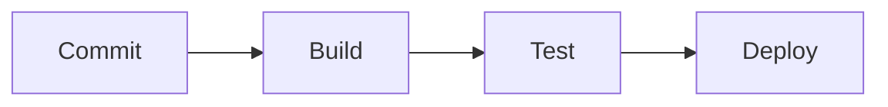
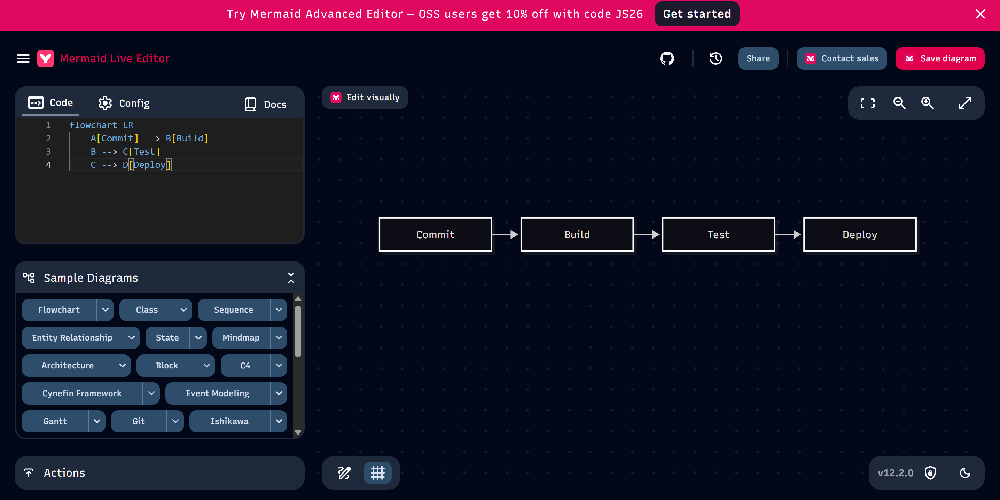

# Zadanie 6: Pierwszy diagram Mermaid

## 1. Prompt

**Prompt:**
> Stwórz prosty diagram Mermaid pokazujący proces CI/CD: commit → build → test → deploy.

## 2. Odpowiedź ChatGPT

## 3. Opis diagramu

Diagram przedstawia podstawowy proces CI/CD składający się z czterech etapów:

1. **Commit** – zapisanie zmian w repozytorium Git.
2. **Build** – zbudowanie aplikacji.
3. **Test** – uruchomienie testów automatycznych.
4. **Deploy** – wdrożenie aplikacji.

Strzałki wskazują kolejność wykonywania poszczególnych etapów.

## 4. Wnioski

Mermaid umożliwia tworzenie diagramów za pomocą prostego kodu tekstowego. Diagram można łatwo edytować i przechowywać bezpośrednio w dokumentacji Markdown.

